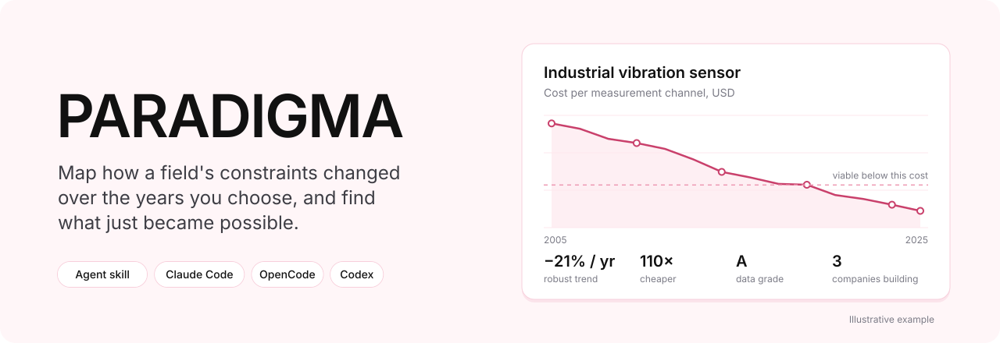
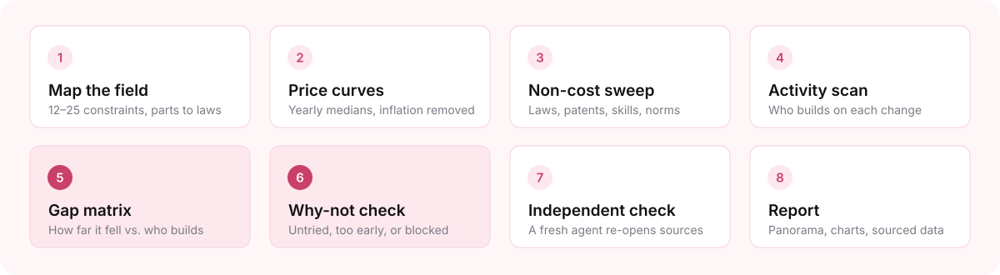
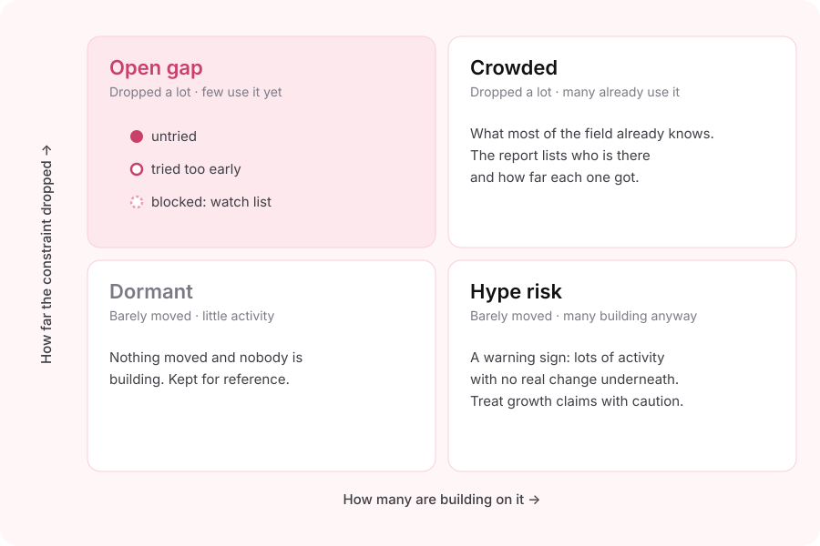

<div align="center">



<br>

**一个智能体技能（Agent Skill）：梳理某个领域的约束在二十年间如何变化，<br>帮助你发现新产品、新创业项目或新研究方向刚刚变得可行的地方。**

[English](../README.md) | [Español](README_es.md) | **简体中文**


[快速开始](#快速开始) · [为什么关注约束](#为什么关注约束) · [工作原理](#工作原理) · [产出内容](#产出内容) · [安装](#安装) · [用法](#用法) · [模型选择](#选择哪个模型运行) · [计算方法](#计算方法) · [局限](#局限) · [常见问题](#常见问题)

</div>

---

## 快速开始

```bash
npx skills add qaemu/paradigm-skill
```

然后在你的智能体中输入：

```text
/paradigma 工业维护
```

大约一小时后，你会得到一份附有来源的报告和一份数据表：工业维护领域中哪些约束已经下降、哪些正在收紧、谁在利用每一项变化，以及空白在哪里。

> [!NOTE]
> PARADIGMA 给你的是一张地图，而不是预测。它展示约束在哪里发生了变化、谁已经注意到。何时行动、针对什么行动，仍然由你判断。

## 为什么关注约束

重大变革很少是前人从未想到的点子。在比特币之前，数字现金已被尝试了二十年。神经网络存在了几十年，直到廉价 GPU 和大规模数据集才让它真正奏效。通常发生变化的是底层：某样东西便宜了 10 倍，一项专利到期，一部法律生效，一种技能不再稀缺，一种社会规范发生转变。整个行业视为固定不变的假设，不再成立。

这些变化通常是公开的，因此单独追踪它们并不能带来优势。优势来自把它们与真正在利用它们的人进行对比。PARADIGMA 就是为你指定的任何领域做这种对比。

| 它是 | 它不是 |
|---|---|
| 一份有来源支撑的领域变化全景 | 一个点子生成器 |
| 用代码计算的稳健趋势，并附置信等级 | 在文字中估算出来的数字 |
| 一张谁在利用每项变化、进展到哪一步的地图 | 一份热门初创公司名单 |
| 坦白说明自身数据的缺口 | 你自身判断的替代品 |

## 工作原理



| 步骤 | 内容 |
|---|---|
| **1. 梳理领域** | 把领域拆解为 12–25 项约束：零部件、制造、软件与 AI、数据、人力、分销、合规、信任。随后用 PESTEL 框架补充政治、经济、社会、技术、环境和法律方面的约束。 |
| **2. 价格曲线** | 辅助智能体并行收集历史数据点，每个数据点都附链接。引擎取每年的中位数，剔除通胀影响，并拟合一条不会被单个错误值带偏的稳健趋势线。 |
| **3. 非成本扫描** | 官方公报、标准组织、即将到期的专利、工资与人才短缺统计、采用率调查、出口管制。每项变化都标注日期，并标记为放松或收紧。 |
| **4. 活动扫描** | 按约束统计公司、融资、专利、论文和产品发布数量，所有约束使用相同的检索方式。每家公司标记为 `announced`（已宣布）、`deployed`（已部署）或 `paying`（已有付费客户），并附证据。 |
| **5. 空白矩阵** | 将每项约束下降的幅度与在其上投入的公司数量进行对比作图。 |
| **6. “为什么没有”检查** | 在把一个空白称为机会之前，先查找失败的尝试和仍然存在的障碍。 |
| **7. 独立核查** | 由一个未参与研究的新智能体重新打开来源，逐一核对每个数值。报告会注明核查通过率。 |
| **8. 报告** | 一页全景概览、每项约束一张卡片、带日期的变化时间线、公司地图，以及包含每个数据点及其链接的数据表。 |

### 不可违反的规则

1. **没有来源，就没有数字。** 找不到的数据如实标为缺失，绝不估算。
2. **所有计算都在引擎中完成**（[`paradigma.py`](../skills/paradigma/scripts/paradigma.py)），而不是在模型的文字里。
3. **一轮融资不等于市场牵引力。** 每家公司都标注状态及其依据。
4. **在“为什么没有”检查完成之前，任何东西都不会被称为空白。**
5. **研究由未参与其中的智能体进行核查。**

## 产出内容

<div align="center">

<br>
<sub>空白矩阵示意图。实际运行时会绘制你所选领域的约束。</sub>
</div>

<br>

| 象限 | 含义 | 报告如何处理 |
|---|---|---|
| **空白**（White space） | 约束大幅下降，但利用者很少 | 进行“为什么没有”检查，并将每一项归类为*未尝试*、*尝试过早*（附失败公司及日期）或*受阻* |
| **拥挤**（Crowded） | 大幅下降，且利用者众多 | 列出公司及各自的进展，这就是共识图景 |
| **炒作风险**（Hype risk） | 变化不大，却仍有很多人投入 | 明确标出 |
| **沉寂**（Dormant） | 变化小，活动也少 | 留作参考 |

**交付物**

- **报告。** 先是全景概览：降幅最大的约束、正在收紧的约束、空白、拥挤领域、炒作风险，以及未来 1–5 年内带日期的变化，例如即将生效的法律和即将到期的专利。然后每项约束一张卡片，包括曲线、年变化率及误差范围、变化倍数、趋势形态、等级、阈值、相关公司和“为什么没有”标签。最后是方法、置信度和来源。
- **数据表。** `constraints`、`points`、`periods`、`curves`、`noncost`、`companies`、`activity`、`gap_matrix`、`whynot` 和 `verification`。每一行都附有来源链接。
- **图表。** 每项约束一条对数刻度曲线，外加空白矩阵。

## 安装

PARADIGMA 遵循开放的 [Agent Skills](https://agentskills.io) 格式：一个 `SKILL.md` 加一个 Python 引擎。任何能够浏览网页、运行 Python，并且最好能启动辅助智能体的智能体都可以使用它。

### 任意智能体（skills CLI）

```bash
npx skills add qaemu/paradigm-skill                    # 当前项目
npx skills add qaemu/paradigm-skill -g                 # 所有项目
npx skills add qaemu/paradigm-skill -a claude-code -a opencode
```

使用 [skills CLI](https://github.com/vercel-labs/skills)，支持 Claude Code、OpenCode、Codex、Cursor 等众多工具。

### Claude Code

作为插件安装，可通过 `/plugin` 获取更新：

```text
/plugin marketplace add qaemu/paradigm-skill
/plugin install paradigma@paradigma
```

插件中的技能带有命名空间前缀，因此运行方式为 `/paradigma:paradigma <领域>`。

或作为个人技能安装，运行方式为 `/paradigma <领域>`：

```bash
git clone https://github.com/qaemu/paradigm-skill.git
mkdir -p ~/.claude/skills && cp -r paradigm-skill/skills/paradigma ~/.claude/skills/
```

### Claude 应用（网页版、桌面版、移动版）

1. 下载 [`dist/paradigma.zip`](../dist/paradigma.zip)。其中包含 `paradigma` 文件夹，内有 `SKILL.md` 和引擎。
2. 在 **Settings → Capabilities** 中开启 **Code execution and file creation**。
3. 进入 **Customize → Skills**，点击 **+**，然后选择 **Create skill → Upload a skill**，上传该 ZIP 文件。

参见 Anthropic 的指南：[Use skills in Claude](https://support.claude.com/en/articles/12512180-use-skills-in-claude)。

### OpenCode

```bash
git clone https://github.com/qaemu/paradigm-skill.git
mkdir -p ~/.config/opencode/skills && cp -r paradigm-skill/skills/paradigma ~/.config/opencode/skills/
```

OpenCode 也会读取 `~/.claude/skills/`，因此在 Claude Code 中安装的技能同样可以在这里使用。请先确认你的服务商支持网页搜索。没有网页搜索，PARADIGMA 无法收集数据。

### 运行要求

| 需要 | 用途 |
|---|---|
| 网页搜索和页面抓取 | 每个数字都来自某个来源 |
| Python 3.10+，以及 `pandas`、`numpy`、`matplotlib`（`scipy` 可选） | 分析引擎 |
| 辅助智能体（可选） | 并行研究和独立核查。没有它们时会逐步执行，并将核查标注为自行核查 |
| `OPENALEX_API_KEY`（可选，[免费](https://openalex.org)） | 共享免费额度用完后用于统计论文数量。没有它时这些列留空，报告中会说明 |

## 用法

```text
/paradigma <领域> [地区] [时间窗口] [standard|deep]
```

| 参数 | 默认值 | 说明 |
|---|---|---|
| `领域` | 必填 | 如果范围很广，比如*硬件*或*医疗*，PARADIGMA 会先建议 3–4 个更具体的子领域。范围越具体，结果越好 |
| `地区` | 全球 | 会标注数据偏重美国或欧盟的部分 |
| `时间窗口` | 截至上一个完整年份的 20 年 | |
| 深度 | `standard` | `standard` 覆盖 12–25 项约束。`deep` 最多覆盖 40 项，曲线数据更密集，并对每个候选项进行“为什么没有”检查 |

```text
/paradigma 农业机械
/paradigma 小批量制造 拉丁美洲
/paradigma 实验室仪器 2010-2025 deep
```

> [!IMPORTANT]
> 一次标准运行大约需要一小时，多个智能体并行工作，会占用套餐中相当一部分用量。`deep` 耗时更长。开始前请先确定领域。

## 选择哪个模型运行

这项任务最看重的是长时任务的可靠性和对来源的严谨态度。一个用看似合理的数字快速填满表格的模型，正是需要避免的失败模式。

| 角色 | 推荐 | 推理强度 |
|---|---|---|
| 主流程（规划、空白矩阵、“为什么没有”、报告） | Claude Opus 5.5 | high |
| 数据收集辅助智能体 | Claude Sonnet 5.5 | medium–high |
| 独立核查 | Opus 5.5，`deep` 运行可用 Claude Fable 5.1 | high |

主流程请避免使用小型模型和 "flash" 类模型。要检验任何模型（包括免费模型），可以让它针对 3 项公开数据充分的约束运行，例如锂离子电池组价格和光伏组件价格，然后逐一打开它返回的链接。**只要编造了一个链接或数字，就算不合格。**

## 计算方法

<details>
<summary><b>曲线如何计算</b></summary>

<br>

1. **标准化。** 数值按单位性能表示（$/kWh、每个传感器通道的价格、每公斤有效载荷的价格）。美元数值使用 FRED 提供的美国 CPI 换算为不变价美元。非美元数值需要附上有出处的汇率，否则会被拒绝。
2. **分组。** 数据按年分组；当数据足够密集时按季度分组：至少 60% 的季度各有至少 3 个点，且至少有 8 个季度。每个周期保留中位数、四分位距和样本数，少于 3 个点的周期会被标记。
3. **拟合。** 对各周期中位数的 log₁₀ 拟合 Theil–Sen 直线，这样每个周期只有一票，离群值几乎不会影响结果。斜率给出年变化百分比及 95% 置信区间。引擎从不把首尾两点之间的百分比当作趋势报告。
4. **形态。** 将最近 5 年与整个时间窗口对比，把趋势归类为加速、平稳或减速。
5. **分类。** 每条曲线归为*改善 ≥10 倍*、*正在改善*、*持平 / 不明确*或*恶化（约束收紧）*。方向取决于该指标是越低越好还是越高越好。
6. **评级。**

| 等级 | 要求 |
|---|---|
| A | ≥ 8 个周期，≥ 3 个独立来源，数据稀少的周期 ≤ 20%，置信区间窄 |
| B | ≥ 5 个周期，≥ 2 个来源 |
| C | 可用但较弱，不能支撑核心结论 |
| D | 少于 3 个周期，不计算趋势 |

</details>

<details>
<summary><b>空白矩阵如何打分</b></summary>

<br>

- **下降得分。** 每项约束每十年改善幅度（变化倍数的 log₁₀）的百分位排名。非成本约束根据证据按 0–3 打分，并附书面理由。跨越可行性阈值会获得加分。
- **活动得分。** 公司、融资、专利、产品发布和招聘信息等可用指标（取对数后）百分位排名的平均值。缺失的指标会被跳过，而不是记为零。
- **研究领先于企业。** 最近 3 年的论文数除以（公司数 + 1）。研究远远领先于企业时，空白得分会提高。
- **空白得分** = 下降得分 × (1 − 活动得分)，并按研究领先程度加权。象限以中位数划分。

这些得分是相对的：它们只在同一领域的约束之间排序，而不是对照某个绝对标准。

</details>

<details>
<summary><b>单独运行引擎</b></summary>

<br>

```bash
cd skills/paradigma/scripts
python3 paradigma.py cpi                  # 从 FRED 获取美国 CPI 年均值
python3 paradigma.py curves --plots       # points.csv -> curves.csv, periods.csv, plots/
python3 paradigma.py papers --start 2005 --end 2025   # OpenAlex 论文数量
python3 paradigma.py gap --plots          # 曲线 + 活动 -> gap_matrix.csv, plots/gap_matrix.png
```

CSV 结构说明见 [`SKILL.md` 附录 B（Appendix B）](../skills/paradigma/SKILL.md#appendix-b-csv-schemas)。

</details>

## 数据来源

PARADIGMA 使用的所有来源都是免费的。报告会注明付费数据库能在哪些方面补充更多信息。

| 需求 | PARADIGMA 使用（免费） | 专业人士额外使用（付费） |
|---|---|---|
| 成本曲线 | Our World in Data、Santa Fe Performance Curve Database、BLS / FRED、USGS、NREL、IEA、价目表 + Wayback Machine | BloombergNEF、拆解分析机构 |
| 公司与融资 | 新闻稿、Crunchbase / Dealroom 免费页面、初创公司名录 | PitchBook、CB Insights、Crunchbase Pro |
| 专利 | Google Patents、Lens.org | PatSnap、Derwent |
| 科研论文 | OpenAlex | Scopus、Web of Science |
| 法规 | 官方公报（Federal Register、EUR-Lex、各国公报）、ISO / IEC / SAE | 法规追踪服务 |

## 局限

- **融资数据是最弱的信号。** 免费来源会遗漏未公开的融资轮次，以及许多美国以外的公司。
- **统计数据偏重美国和欧盟。** 报告会标注地区偏差。
- **太早和错了看起来是一样的。** 不到 3 年的下降会被标记为*早期*。
- **投机驱动的活动不等于真实采用。** 报告会把炒作与有真实需求的用户区分开。
- **状态：v0.1，实验性。** 引擎通过了一套基于已知答案合成数据的离线测试。目前尚未发布完整的真实运行结果，第一份将添加到 `examples/`。

## 常见问题

**它会动我的文件或账户吗？**
不会。它只读取公开网站，只写入自己的工作文件夹，也不会登录任何地方。

**为什么不直接让模型写一份市场报告？**
因为它会给你一份，连数字都有，而你无法分辨哪些数字是编造的。PARADIGMA 要求每个数字都有来源，用代码完成计算，并由另一个智能体核查结果。

**可以用免费模型吗？**
可以，前提是该模型通过[选择哪个模型运行](#选择哪个模型运行)中的测试。请先查看各服务商的数据政策，因为有些免费模型会用你的提示词进行训练。

**它和咨询公司的市场报告有什么不同？**
市场报告衡量的是市场规模。PARADIGMA 关注的是：支撑一个市场的哪些假设已经不再成立，以及谁已经注意到了。

## 仓库结构

```text
paradigm-skill/
├── .claude-plugin/          Claude Code 插件市场与插件清单
├── skills/paradigma/
│   ├── SKILL.md             智能体遵循的指令
│   └── scripts/paradigma.py 分析引擎（曲线、空白矩阵、CPI、论文）
├── tests/test_engine.py     使用已知答案的离线测试
├── dist/paradigma.zip       可直接上传到 Claude 应用的技能包（tools/package.sh）
├── tools/                   make_assets.py（README 插图）、package.sh（重新打包 ZIP）
├── README/                  README 的翻译版本
└── assets/                  横幅、流程图和空白矩阵插图
```

```bash
python3 tests/test_engine.py   # 应输出 10 行 PASS
```

## 参与贡献

欢迎提交 Issue 和 Pull Request，尤其是：

- 你愿意分享到 `examples/` 的真实运行结果
- 针对特定领域或地区的更好的免费数据来源
- PARADIGMA 报告的空白后来被证明是错误的案例，以及原因

请保持规则不变：每个数字都要有来源，所有计算都留在引擎中。

## 许可证

[MIT](../LICENSE) © 2026 qaemu

<div align="center">
<br>
<sub>由 <a href="https://github.com/qaemu">qaemu</a> 开发。同一作者的其他项目：<a href="https://github.com/qaemu/phasentic">Phasentic</a>，开源的粉末 X 射线衍射物相鉴定工具。</sub>
</div>
