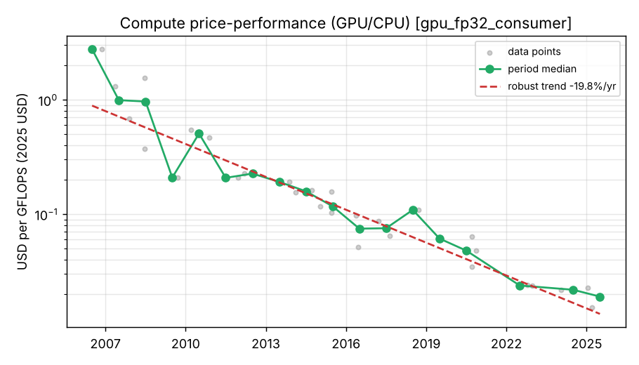
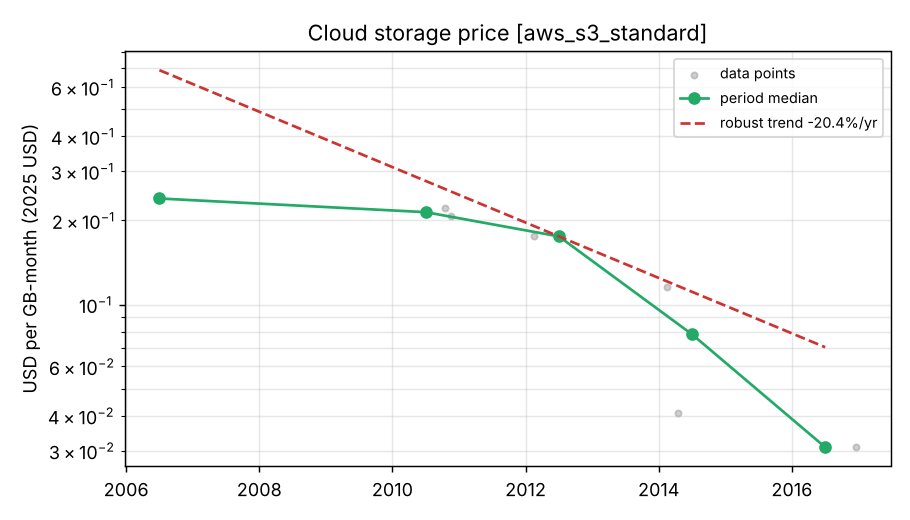
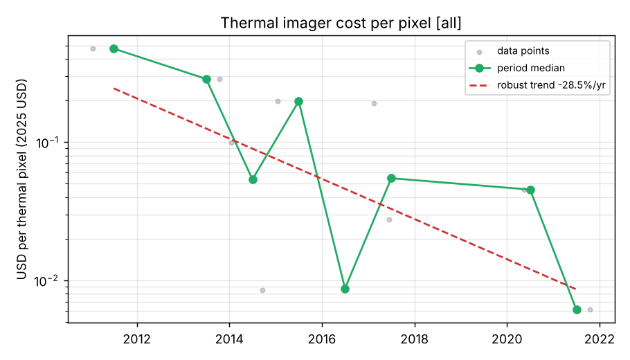
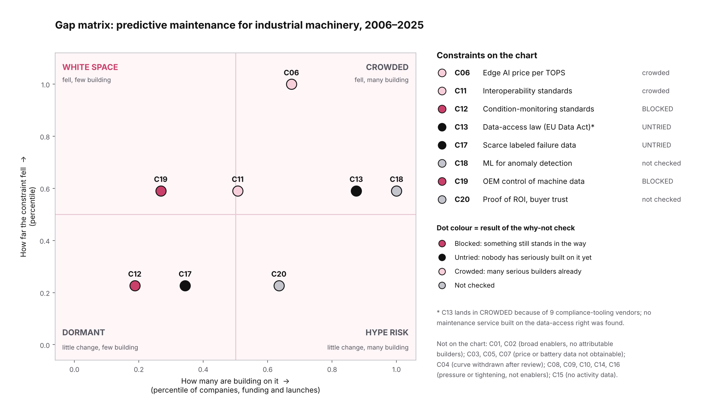

# PARADIGMA scan: predictive maintenance for industrial machinery

> Example run of [PARADIGMA](https://github.com/qaemu/paradigma-skill). Field: **predictive maintenance for industrial machinery**. Region: global (sources skew US/EU). Window: **2006–2025**. Run date: **2026-10-13**. Depth: standard (20 constraints). Ran on Claude Sonnet 5.5 with sub-agents for research and for the independent check.

**Read this first.** This is a panorama, not a business plan. The data is public-web only, several curves could not be built to standard, and the activity scan is thin outside the US and EU. Every number below has a source URL in `data/` and was re-checked by agents that did not collect it (pass rate in [Method and confidence](#6-method-and-confidence)). Where data is missing, the report says missing.

## 1. Panorama

**Bottom line.** The cheap-hardware story for predictive maintenance (PdM) is mostly finished and has plateaued. What is left is institutional: who may read machine data, who controls it, whether buyers believe the ROI, and the lack of labeled failure data. No firm white space survived the why-not check. One candidate is still open with low confidence: third-party PdM services built on the EU Data Act's access right.

### What fell (measured)

| Constraint | Result | Grade | Caveat |
|---|---|---|---|
| C02 Compute price-performance (GPU, fp32, consumer) | **~66× cheaper per GFLOPS** over 19 years; -19.8%/yr (95% CI -23.1 to -17.1); trend decelerating | B | Wikipedia launch-price tables only; all 30 rows matched the page. Base-clock fp32. |
| C01 Cloud storage (AWS S3 standard) | **$0.15 → $0.023 per GB-month** list price (2006–2016), observed real fall 7.8×. **Flat since Dec 2016** (still $0.023 on 2026-10-12, outside the window). | B | Price moves in steps, so the log-linear fit (-20%/yr) fits badly; use the observed fold. GCS and Azure series too short to grade. |
| C06 Edge AI price per TOPS | $37 → $3.7 per TOPS (2019–2024); fit -30%/yr but the 95% CI crosses zero (-52 to +17) | C | 6 points, mixed TOPS definitions (sparse, 15 W mode). Not a headline. |

| GPU price per GFLOPS | AWS S3 price per GB-month | Entry thermal imagers (withdrawn) |
|---|---|---|
|  |  |  |

### What the engine said fell, and the check withdrew

- **C04 Entry thermal imagers.** The robust fit says −28%/yr and ~28× over 2011–2021. The why-not agent found this is a **one-time step when Seek entered in 2014** (about $0.006 per pixel against $0.146 for FLIR's C2 in 2015) and the per-pixel price has been roughly flat since. The curve mixes vendors and pixel counts. Grade lowered to C and C04 is excluded from the matrix. The scan also had only 1 company on it; a follow-up found at least 8 sellers, so the first-pass "white space" was a scan gap too.

### What could not be measured to standard (data gaps, not findings)

- **C03 Vibration-sensor price**, **C05 cellular IoT module price**, **C07 wireless-sensor battery life.** No usable time series. Wayback Machine snapshots were blocked in this environment, and the market-research price series are paywalled. Single 2026 price snapshots exist (outside the window) but are not a curve. These three are the most useful constraints for PdM and the least measured. A paid source (Yole, Counterpoint, distributor price histories) would fix this.

### What tightened or pressed

- **Cost of unplanned downtime** rose, but from three different survey editions: automotive $1.34M/h (Senseye 2021, reference 2019–20) → $2.0M (Senseye 2022) → $2.3M (Siemens 2024). Fit +14%/yr (CI +4 to +38). Grade C, indicative only.
- **Skills shortage is not visible in wages.** US industrial machinery mechanics (BLS 49-9041): employment 250,810 (2006) → 412,650 (2023), +65%, while the real median wage was flat (+0.2%/yr, CI +0.01 to +0.36) and fell about 9% from 2021 to 2023 in 2025 dollars. Shortage figures come from manufacturing-wide studies (Deloitte/Manufacturing Institute: 1.9M jobs unfilled by 2033). BLS data stops at May 2023 here.
- **Compliance load is rising** for connected, AI-driven machines: EU Machinery Regulation (applies 2027-01-20), Cyber Resilience Act (reporting since 2026-09-11, full application 2027-12-11). The AI Act's high-risk dates were pushed back by the Digital Omnibus on AI.

### White space after the why-not check

| Candidate | Label | Confidence | Why |
|---|---|---|---|
| C13 PdM services built on EU Data Act access | **UNTRIED** | Low | The Act applies from 2025-09-12 and design-for-access from 2026-09-12. We found 9 compliance and intermediary tooling vendors (plus Volvo CE and Deere as OEM cases) and no PdM service using the access right (17 queries for C13, see `absence.csv`). But the Act limits what a PdM provider can get: only data the manufacturer designed to be retrievable, derived or inferred outputs excluded per the Commission FAQ, trade-secret refusals available to OEMs, and only products placed on the market after 2026-09-12. It is too early to call it failed; the scope limits are real blockers if a service needs derived data. |
| C17 Labeled failure data | **UNTRIED** | Low | No startup found selling synthetic failure data, cross-company failure exchange or run-to-failure rigs. Research is far ahead of companies (2,756 papers 2023–2025 against 5 tagged companies). The constraint did not fall, so this is a **persistent bottleneck**, not an opening window. Cross-company sharing is blocked by confidentiality. |

**Watch list (BLOCKED):** C19 OEM control of machine data. Retrofit vendors are OEM-independent in practice, and explicit anti-lock-in selling exists only in wind and elevators (ONYX Insight, Modusystem). No failed startup or OEM lawsuit found in industrial PdM. The blocker (OEM service agreements, access to PLC/CNC data) did not move between 2018 and 2022 in the wind data (vendor claims: 1 of 11 CMS vendors gave full data access in 2018, 1 of 12 in 2022). C12 CM and prognostics standards: voluntary, and no regulator or insurer requiring buyers to cite them was found.

### Crowded and hype-risk zones

- **Crowded:** C18 ML for anomaly detection and prognostics (26 companies, 12 deployed, 4 paying; research 3,554 papers). C06 edge AI at the chip layer (Mythic nearly collapsed in 2022, Untether AI shut down 2025-06; for vibration PdM the accelerator is not the binding input). C11 data integration (GE Predix retreated in 2018; Cognite is the counter-example, with Schneider's announced $3.1B acquisition on 2026-06-30 from a secondary source). C04 handheld thermal imagers (8+ sellers).
- **Hype risk:** C20 ROI and buyer trust. 9 companies, constraint barely moved. Evidence is vendor-reported: IoT Analytics says 95% of adopters see positive ROI but discloses no method; HSB's 506% ROI is client-reported; Augury's HSB-backed loss guarantee is capped at $100k per incident. No quantified insurer discount found.

### Dated changes in the next 1–5 years

| Date | Change | Direction |
|---|---|---|
| 2026-10 | ISO 20816-1 second edition under publication (stage 60.00 on 2026-10-07) | loosening |
| 2026-12-07 | US7395188B1 (GE, equipment life estimation) reaches filing date + 20 years | loosening |
| 2027-01-20 | EU Machinery Regulation 2023/1230 applies (covers connected equipment and AI-based safety functions) | tightening |
| 2027-09-12 | Data Act Chapter IV unfair-terms rules reach older long-term contracts | loosening |
| 2027-12-02 | AI Act high-risk obligations for Annex III systems (deferred by Reg. 2026/1744) | loosening |
| 2027-12-11 | Cyber Resilience Act main obligations apply in full | tightening |
| 2028-08-02 | AI Act high-risk obligations for AI in regulated products (deferred by Reg. 2026/1744) | loosening |

Already in force this autumn: CRA vulnerability reporting (2026-09-11), Data Act design-for-access (2026-09-12), Digital Omnibus on AI (2026-07-27). The Data Act omnibus amendments are still a proposal. Patent dates are approximate; no evidence was found that any of the expiring patents blocked entrants.

## 2. Gap matrix

Drop score is the percentile of how far each constraint fell (measured curve, or 0–3 qualitative score). Activity score is the percentile of companies, funding and launches building on it. The matrix covers only 8 constraints with both signals; the rest are listed under the chart and in the cards. Activity comes from tags that agents could support from an opened page, so it is a lower bound.

| Constraint | Drop | Activity | Papers 2023–25 (prior 3y) | Quadrant | Why-not |
|---|---|---|---|---|---|
| C19 OEM control of machine data and service contracts | 0.59 | 0.27 | 198 (68) | WHITE SPACE | BLOCKED |
| C06 Edge AI accelerator price per TOPS | 1.00 | 0.67 | 998 (163) | CROWDED | N/A-CROWDED |
| C11 Data interoperability standards (OPC UA, MQTT/Sparkplug, IO-Link, MTConnect) | 0.59 | 0.51 | 797 (131) | CROWDED | N/A-CROWDED |
| C12 Condition-monitoring and prognostics standards (ISO 20816, 17359, 13381, 55000) | 0.23 | 0.19 | 116 (81) | DORMANT | BLOCKED |
| C17 Scarcity of labeled failure data | 0.23 | 0.34 | 2756 (1040) | DORMANT | UNTRIED |
| C20 Proof of ROI and buyer trust | 0.23 | 0.63 | 148 (28) | HYPE RISK |  |
| C13 Machine data access law (EU Data Act, right to repair) | 0.59 | 0.88 | 108 (16) | CROWDED | UNTRIED |
| C18 ML capability for anomaly detection and prognostics | 0.59 | 1.00 | 3554 (1295) | CROWDED |  |

## 3. Constraint cards

Thresholds ("what became viable at today's level, and at the next 10×") were **not established** for any constraint: no cited first product or deployment was collected for a threshold. This is a limitation of this run.

#### C01 Cloud storage price

- **What it is:** cost; Vibration/current waveforms are bulky; cheap storage makes keeping raw history viable. Direction after review: loosening (measured).
- **Curve (aws_s3_standard):** 7 points, 5 periods, 6 sources; robust change -20.4%/yr (95% CI -37.2 to -2.8); improvement fold over window 9.81; shape accelerating; grade B. Step-shaped price history; plateau since 2016.
- **Who builds:** no attributable company found in the scan. That means unknown, not zero. Papers 511 (2023–25) vs 157 (2020–22).
- **Key sources:** [aws.amazon.com](https://aws.amazon.com/blogs/aws/aws-storage-update-s3-glacier-price-reductions); [web.archive.org](https://web.archive.org/web/20101007165055/http://aws.amazon.com/s3/pricing/); [aws.amazon.com](https://aws.amazon.com/blogs/aws/what-can-i-say-another-amazon-s3-price-reduction/)

#### C02 Compute price-performance (GPU/CPU)

- **What it is:** cost; Training and running fault-detection models at scale. Direction after review: loosening (measured).
- **Curve (gpu_fp32_consumer):** 30 points, 18 periods, 2 sources; robust change -19.8%/yr (95% CI -23.1 to -17.1); improvement fold over window 66.26; shape decelerating; grade B. Secondary-sourced (Wikipedia), base-clock fp32.
- **Who builds:** no attributable company found in the scan. That means unknown, not zero. Papers 2825 (2023–25) vs 724 (2020–22).
- **Key sources:** [en.wikipedia.org](https://en.wikipedia.org/wiki/List_of_Nvidia_graphics_processing_units); [en.wikipedia.org](https://en.wikipedia.org/wiki/List_of_AMD_graphics_processing_units)

#### C03 Vibration sensing hardware cost

- **What it is:** cost; Sensing is the first physical step; industrial-grade vs consumer-grade matters. Direction after review: unmeasured (data gap).
- **Curve:** not computed (fewer than 3 distinct periods in the best tier, grade D). No usable history: only 2008 and 2013 consumer MEMS points and single 2026 snapshots.
- **Who builds:** 14 companies tagged (2 founded 2012+; 12 consensus; statuses: announced=7, deployed=7). Funding 2021-10 to 2026-10 attributed to tagged companies: $189M (rounds de-duplicated per company; a company tagged to several constraints counts under each). Papers 342 (2023–25) vs 197 (2020–22).
- **Key sources:** [www.edn.com](https://www.edn.com/?p=4076911); [www.electronicspecifier.com](https://www.electronicspecifier.com/?p=123281); [www.electronicspecifier.com](https://www.electronicspecifier.com/?p=51261)

#### C04 Thermal imager cost per pixel

- **What it is:** cost; Infrared thermography finds electrical/mechanical hot spots. Direction after review: measured, excluded after review.
- **Curve (all):** 11 points, 8 periods, 10 sources; robust change -28.5%/yr (95% CI -55.0 to -6.1); improvement fold over window 28.54; shape decelerating; grade C (engine said B). Curve withdrawn after review: vendor swap step in 2014, flat since.
- **Who builds:** 8 companies tagged (1 founded 2012+; 4 consensus; statuses: deployed=5, announced=2, paying=1). Funding 2021-10 to 2026-10 attributed to tagged companies: n/a (rounds de-duplicated per company; a company tagged to several constraints counts under each). Papers 220 (2023–25) vs 110 (2020–22).
- **Why-not:** **N/A-CROWDED.** mixed: per-pixel price of complete imagers has been flat since 2014 (see note); NFPA 70B 2023 and insurer pressure raise demand (falling barrier); export rules, emissivity and line-of-sight unchanged; contact-sensor substitutes improving.
- **Key sources:** [www.postbulletin.com](https://www.postbulletin.com/business/flir-systems-introduces-the-lowest-price-advanced-thermal-imaging-camera); [mechanical-hub.com](https://mechanical-hub.com/flir-e-series-thermal-cameras/); [www.flir.com](https://www.flir.com/news-center/press-releases/flir-systems-introduces-first-thermal-imager-designed-for-smartphones/)

#### C05 Cellular IoT module price

- **What it is:** cost; Connectivity cost per monitored asset. Direction after review: unmeasured (data gap).
- **Curve:** not computed (fewer than 3 distinct periods in the best tier, grade D). Five single points across four technologies; no series.
- **Who builds:** 5 companies tagged (0 founded 2012+; 3 consensus; statuses: announced=2, deployed=2, paying=1). Funding 2021-10 to 2026-10 attributed to tagged companies: $30M (rounds de-duplicated per company; a company tagged to several constraints counts under each). Papers 54 (2023–25) vs 15 (2020–22).
- **Key sources:** [web.archive.org](https://web.archive.org/web/20200923192312/https://www.digikey.com/product-detail/en/u-blox/SARA-R410M-02B/672-SARA-R410M-02BCT-ND/9565823); [web.archive.org](https://web.archive.org/web/20170516222917/https://www.digikey.com/product-detail/en/sierra-wireless/HL7588_1102561/1645-1003-1-ND/5843823); [web.archive.org](https://web.archive.org/web/20191020065026/https://www.digikey.com/product-detail/en/sierra-wireless/HL8518_1103928/1645-1121-1-ND/10136459)

#### C06 Edge AI accelerator price per TOPS

- **What it is:** cost; Running models next to the machine without cloud round trip. Direction after review: loosening (measured).
- **Curve (edge_module_board):** 6 points, 3 periods, 6 sources; robust change -29.8%/yr (95% CI -52.4 to +17.4); improvement fold over window 6.20; shape steady; grade C. 6 points; CI crosses zero.
- **Who builds:** 10 companies tagged (2 founded 2012+; 6 consensus; statuses: announced=5, deployed=4, paying=1). Funding 2021-10 to 2026-10 attributed to tagged companies: $547M (rounds de-duplicated per company; a company tagged to several constraints counts under each). Papers 998 (2023–25) vs 163 (2020–22).
- **Why-not:** **N/A-CROWDED.** mixed: compute price per TOPS falling (C06 curve: -30%/yr, low confidence), ML-methods barriers (labels, drift, explainability) falling slowly; safety-function certification gap unchanged; chip-supplier consolidation raises entrant risk.
- **Key sources:** [web.archive.org](https://web.archive.org/web/20191114020217/https://coral.ai/products/dev-board); [web.archive.org](https://web.archive.org/web/20191030134804/https://coral.ai/products/accelerator); [web.archive.org](https://web.archive.org/web/20200623191317/https://coral.ai/products/accelerator)

#### C07 Battery life of wireless vibration sensors

- **What it is:** performance; Battery changes kill the economics of dense wireless monitoring. Direction after review: unmeasured (data gap).
- **Curve:** not computed (fewer than 3 distinct periods in the best tier, grade D). Reporting intervals differ between vendors (1 min to 6 h); no comparable series.
- **Who builds:** 10 companies tagged (3 founded 2012+; 6 consensus; statuses: announced=7, deployed=2, paying=1). Funding 2021-10 to 2026-10 attributed to tagged companies: $162M (rounds de-duplicated per company; a company tagged to several constraints counts under each). Papers 62 (2023–25) vs 43 (2020–22).
- **Key sources:** [d1-live.emerson.com](https://d1-live.emerson.com/documents/automation/product-data-sheet-ams-9420-wireless-vibration-transmitter-en-38490.pdf); [d1-live.emerson.com](https://d1-live.emerson.com/documents/automation/product-data-sheet-ams-wireless-vibration-monitor-ams-en-7030352.pdf); [www.shopibt.com](https://www.shopibt.com/UserFiles/brands/featured_brands/schaeffler/OPTIME_Condensed.pdf)

#### C08 Cost of unplanned downtime

- **What it is:** economic; Rising downtime cost raises the pull for prediction (pressure, not an enabler). Direction after review: pressure (measured).
- **Curve (automotive):** 3 points, 3 periods, 3 sources; robust change +13.9%/yr (95% CI +3.6 to +37.9); improvement fold over window 0.68; shape accelerating; grade C. Three survey editions from two publishers; indicative only.
- **Who builds:** 8 companies tagged (4 founded 2012+; 6 consensus; statuses: announced=4, paying=3, deployed=1). Funding 2021-10 to 2026-10 attributed to tagged companies: $368M (rounds de-duplicated per company; a company tagged to several constraints counts under each). Papers 840 (2023–25) vs 122 (2020–22).
- **Key sources:** [www.automation.com](https://www.automation.com/en-us/articles/june-2021/world-largest-manufacturers-lose-almost-1-trillion); [www.automation.com](https://www.automation.com/article/year-to-machine-failure); [www.operationsengineer.org.uk](https://www.operationsengineer.org.uk/content/news/worlds-largest-manufacturers-lose-15-trillion-a-year-to-production-outages)

#### C09 Industrial machinery mechanic wage

- **What it is:** skill; Rising wages push automation of inspection rounds. Direction after review: pressure (measured).
- **Curve (all):** 18 points, 18 periods, 18 sources; robust change +0.2%/yr (95% CI +0.0 to +0.4); improvement fold over window 0.97; shape accelerating; grade B. Real wage flat; series ends May 2023.
- **Who builds:** no attributable company found in the scan. That means unknown, not zero.
- **Key sources:** [web.archive.org](https://web.archive.org/web/20081015053850/http://www.bls.gov/oes/2006/may/oes499041.htm); [web.archive.org](https://web.archive.org/web/20090208205714/http://www.bls.gov:80/oes/2007/may/oes499041.htm); [web.archive.org](https://web.archive.org/web/20090507122403/http://www.bls.gov/oes/2008/may/oes499041.htm)

#### C10 Maintenance labor and skills gap

- **What it is:** skill; Fewer experienced technicians and vibration analysts per machine. Direction after review: tightening.
- **Qualitative score 1/3 (tightening, weak):** Weak tightening. Deloitte/Manufacturing Institute project 1.9M unfilled manufacturing jobs by 2033 (2024 study; 2.4M by 2028 in the 2018 study), but those are manufacturing-wide. For industrial machinery mechanics (49-9041), BLS employment rose from 250,810 (2006) to 412,650 (2023) while the real median wage was flat (+0.2%/yr, C09). Shortage claims are not visible in the wage data. Sources: labor_facts_D.csv, points.csv C09.
- **Who builds:** 16 companies tagged (6 founded 2012+; 12 consensus; statuses: announced=10, deployed=4, paying=2). Funding 2021-10 to 2026-10 attributed to tagged companies: $569M (rounds de-duplicated per company; a company tagged to several constraints counts under each). Papers 451 (2023–25) vs 38 (2020–22).

#### C11 Data interoperability standards (OPC UA, MQTT/Sparkplug, IO-Link, MTConnect)

- **What it is:** norm; Getting machine data out of mixed-vendor plants. Direction after review: loosening.
- **Qualitative score 2/3 (loosening):** Significant loosening, not a removed hard barrier. OPC UA reached IEC 62541 status (E002), gained PubSub with MQTT transport in 2018 (E004) and MQTT 5 in 2023 (E005); FX v1.0 (E006) and its 2025 certification program (E007) extend to field level; OPC 40001 Machinery building blocks and process values (E008, E009) and umati's ~25 published machinery companion specs (E016) give shared semantics; Sparkplug 3.0 (E015) and MTConnect (E012, E010) cover MQTT and machine-tool niches; OPC membership passed 1,000 in 2024 (E011). Held at 2 because no condition-monitoring-specific companion spec, ISO/IEC 20237 recognition of Sparkplug, IO-Link node counts or shipped-product numbers were confirmed (E015, E017 notes), and several competing stacks remain.
- **Who builds:** 10 companies tagged (1 founded 2012+; 2 consensus; statuses: announced=5, deployed=5). Funding 2021-10 to 2026-10 attributed to tagged companies: $34M (rounds de-duplicated per company; a company tagged to several constraints counts under each). Papers 797 (2023–25) vs 131 (2020–22).
- **Why-not:** **N/A-CROWDED.** falling slowly: OPC UA/MQTT/umati adoption rising and EU Data Act design-for-access since 2026-09-12, but brownfield age, security zoning and semantics gaps unchanged; CRA/IEC 62443 compliance load rising.
- **Key sources:** [opcfoundation.org](https://opcfoundation.org/wp-content/uploads/2025/10/2025-10-29-OPCF-History.pdf); [en.wikipedia.org](https://en.wikipedia.org/wiki/MTConnect); [sparkplug.eclipse.org](https://sparkplug.eclipse.org/specification/)

#### C12 Condition-monitoring and prognostics standards (ISO 20816, 17359, 13381, 55000)

- **What it is:** norm; Shared vocabulary and thresholds buyers can cite. Direction after review: loosening.
- **Qualitative score 1/3 (loosening):** Minor loosening: an incremental refresh of an existing voluntary framework rather than a new enabling standard. ISO 17359 is at its 2018 third edition (E019, E020, E021); the ISO 10816/7919 family was consolidated into ISO 20816 (E022-E025) with edition 2 of Part 1 under publication in Oct 2026 (E026) and Part 3 under revision (E027); ISO 13373 gained machine-specific parts through 2026 (E028, E029); ISO 13374 data-flow architecture dates from 2003-2015 (E030); ISO 13379-1 and ISO 13381-1 prognostics were re-issued in 2025 (E031, E032, E033); ISO 55000 second edition 2024 (E034, E035); ISO 18436 certification parts continue (E036). Nothing new in 2023-2026 creates a PdM-specific data model, and no IEC/IEEE PdM standard (IEC TR 63283 series, IEEE 1856) could be verified, so this is a coverage gap.
- **Who builds:** 5 companies tagged (0 founded 2012+; 2 consensus; statuses: announced=5). Funding 2021-10 to 2026-10 attributed to tagged companies: n/a (rounds de-duplicated per company; a company tagged to several constraints counts under each). Papers 116 (2023–25) vs 81 (2020–22).
- **Why-not:** **BLOCKED.** Flat. Standards content refreshed (ISO 13381-1:2025, 13379-1:2025, 20816-1 ed.2 forecast Oct 2026) but no new mandate or insurer link found; the ISO 55001 uptake barrier is unchanged since the 2017 panel as far as the evidence goes..
- **Key sources:** [www.iso.org](https://www.iso.org/contents/data/committee/05/15/51538/x/catalogue/p/1/u/0/w/0/d/0); [www.iso.org](https://www.iso.org/standard/71194.html); [www.iso.org](https://www.iso.org/standard/63180.html)

#### C13 Machine data access law (EU Data Act, right to repair)

- **What it is:** legal; Whether third parties can legally read machine data. Direction after review: loosening.
- **Qualitative score 2/3 (loosening):** Significant loosening for access to machine data, mostly in the EU. The Data Act applies since 12 Sep 2025 (E039) and covers industrial and agricultural machinery as connected products (E038); the design-for-access obligation for products placed on the market after 12 Sep 2026 is already in effect (E040); unfair-terms rules reach older long-term contracts from 12 Sep 2027 (E041). Offsetting factors: raw/pre-processed data only, a no-compete clause on the data, and the pending Digital Omnibus (E042) which could add trade-secret refusal grounds. The EU repair directive (E043, E044) is consumer-oriented. US state laws largely exclude industrial equipment (Minnesota E047; Colorado E045 covers agriculture only; E046), and the Deere settlement (E048) is agricultural, proposed and not yet confirmed as entered. UK (E049) unconfirmed for industrial scope. India, China, Japan, New York, California and Argentina were not verified.
- **Who builds:** 12 companies tagged (1 founded 2012+; 3 consensus; statuses: announced=7, deployed=5). Funding 2021-10 to 2026-10 attributed to tagged companies: n/a (rounds de-duplicated per company; a company tagged to several constraints counts under each). Papers 108 (2023–25) vs 16 (2020–22).
- **Why-not:** **UNTRIED.** Mixed. Falling: Art. 3(1) design duty live since 2026-09-12; unfair-terms rules reach older long-term contracts from 2027-09-12 (Art. 50 as mirrored by springlex); national enforcement spreading (Germany 2026-05-30); SME cost cap on compensation. Rising: Digital Omnibus (COM(2025)837) would drop the 'exceptional circumstances' qualifier, lower 'highly likely' to 'likely' and add a third-country-risk refusal ground (NatLawReview 2026-07-15); Council mandate sought in Coreper note 10729/26 dated 2026-06-22 (trade-secret recital 11); Parliament (ITRE and LIBE) position outstanding; still a proposal as of 2026-09-29. Net: scope and trade-secret blockers rising or flat, access mechanics falling..
- **Key sources:** [digital-strategy.ec.europa.eu](https://digital-strategy.ec.europa.eu/en/policies/data-act); [www.springlex.eu](https://www.springlex.eu/en/packages/data-act/data-act-regulation/article-50/); [www.europarl.europa.eu](https://www.europarl.europa.eu/legislative-train/theme-a-new-plan-for-europe-s-sustainable-prosperity-and-competitiveness/file-digital-package)

#### C14 Machinery, AI and cyber compliance (EU Machinery Reg, AI Act, CRA)

- **What it is:** legal; Compliance cost and liability for connected, AI-driven machines. Direction after review: tightening.
- **Qualitative score 2/3 (tightening):** Significant tightening (compliance cost and design obligations), partly softened by delay. CRA reporting under Art. 14 applies since 11 Sep 2026 (E061), with full application 11 Dec 2027 (E062) and Chapter IV from 11 Jun 2026 (E060); Machinery Regulation applies 20 Jan 2027 (E050, E051); NIS2 transposition is overdue in several states (E063); IEC 62443 is the de facto technical route (E064). AI Act: general application 2 Aug 2026 (E056), but Reg. 2026/1744, in force 27 Jul 2026 (E052), moved Annex III high-risk to 2 Dec 2027 (E057) and Annex I to 2 Aug 2028 (E058) and carved machinery out of direct high-risk rules, so the AI hurdle for PdM is smaller than before. Scored 2 not 3: no new hard prohibition on PdM, most obligations hit hardware makers (sensors, gateways, machine builders) more than analytics vendors, and the scope of each law for PdM software was not verified. US CIRCIA final rule has no effective date (E065).
- **Who builds:** 1 companies tagged (0 founded 2012+; 1 consensus; statuses: announced=1). Funding 2021-10 to 2026-10 attributed to tagged companies: n/a (rounds de-duplicated per company; a company tagged to several constraints counts under each). Papers 797 (2023–25) vs 66 (2020–22).
- **Key sources:** [eur-lex.europa.eu](https://eur-lex.europa.eu/eli/reg/2023/1230/oj/eng); [osha.europa.eu](https://osha.europa.eu/en/legislation/directive/regulation-20231230eu-machinery); [eur-lex.europa.eu](https://eur-lex.europa.eu/eli/reg/2026/1744/oj/eng)

#### C15 Early predictive-maintenance patents

- **What it is:** patent; Expiring or lapsed core patents free up methods. Direction after review: loosening.
- **Qualitative score 1/3 (loosening):** Only a few generic prognosis/diagnosis patents with 2005-2008 filings were confirmed (F001-F004), all expiring roughly 2025-2027; two more (F005-F006, priority 2006/filed 2009-2010) lapsed early for unpaid fees per Google labels; earlier prior art already expired 2020-2023 (F007-F009). No evidence found that any of these actually blocked entrants; no Lens/Espacenet access, citation ranking not done.
- **Who builds:** no attributable company found in the scan. That means unknown, not zero.
- **Key sources:** [patents.google.com](https://patents.google.com/patent/US7222048); [patents.google.com](https://patents.google.com/patent/US7328128); [patents.google.com](https://patents.google.com/patent/US7395188)

#### C16 Chip supply and trade barriers

- **What it is:** supply; MEMS and MCU availability, lead times, tariffs. Direction after review: mixed.
- **Qualitative score 2/3 (mixed):** Component shortage eased (record 26.6 weeks Mar 2022, F010-F012; flat-to-falling at 27 weeks by Jun 2022 and forecast to fall in 2023, F013-F014) while US-China tariffs and controls tightened (F015-F016, F019, F022) then partly loosened (F020-F021, F023-F024). Net effect on industrial sensors/MCUs not isolated; Z2Data and mature-node tariff coverage not verified.
- **Who builds:** no attributable company found in the scan. That means unknown, not zero.
- **Key sources:** [www.theregister.com](https://www.theregister.com/2022/04/14/semiconductor_lead_times/); [www.businesswire.com](https://www.businesswire.com/news/home/20210715005194/en/Supplyframe-Commodity-Intelligence-Quarterly-Points-to-Increasing-Risk-and-Supply-Constraints-for-Manufacturers); [www.bnnbloomberg.ca](https://www.bnnbloomberg.ca/chip-delivery-times-fall-by-a-day-as-companies-see-some-relief-1.1788467)

#### C17 Scarcity of labeled failure data

- **What it is:** data; Few plants have enough run-to-failure examples to train on. Direction after review: loosening.
- **Qualitative score 1/3 (loosening):** Public bearing/engine datasets exist since 2008 (F026-F034) and simulation/GAN approaches are emerging (F035), but all are small (e.g. 17 bearings in PRONOSTIA, F030) and authors still report failure data as scarce (F030, F034, F036). No cross-company data-sharing initiative found.
- **Who builds:** 5 companies tagged (1 founded 2012+; 3 consensus; statuses: announced=4, deployed=1). Funding 2021-10 to 2026-10 attributed to tagged companies: $82M (rounds de-duplicated per company; a company tagged to several constraints counts under each). Papers 2756 (2023–25) vs 1040 (2020–22).
- **Why-not:** **UNTRIED.** flat: datasets small and unchanged; data-ownership blocker (C19) not falling; simulation/GAN methods emerging in papers only.
- **Key sources:** [c3.ndc.nasa.gov](https://c3.ndc.nasa.gov/dashlink/static/media/publication/2008_IEEEPHM_CMAPPSDamagePropagation.pdf); [www.nasa.gov](https://www.nasa.gov/intelligent-systems-division/discovery-and-systems-health/pcoe/pcoe-data-set-repository/); [engineering.case.edu](https://engineering.case.edu/bearingdatacenter/welcome)

#### C18 ML capability for anomaly detection and prognostics

- **What it is:** performance; TinyML, unsupervised detection, time-series foundation models, LLM copilots. Direction after review: loosening.
- **Qualitative score 2/3 (loosening):** Embedded ML runtimes fit in KBs (F037) and open pre-trained time-series models appeared in 2024 (F038-F040), but benchmarks are generic forecasting/anomaly sets with mixed wins (MOMENT loses on VUS-ROC to k-NN); no machinery-specific benchmark evidence. 2019 TinyML/Edge Impulse launches, Chronos and LLM maintenance copilots were not verified and have no rows.
- **Who builds:** 26 companies tagged (12 founded 2012+; 19 consensus; statuses: deployed=12, announced=10, paying=4). Funding 2021-10 to 2026-10 attributed to tagged companies: $704M (rounds de-duplicated per company; a company tagged to several constraints counts under each). Papers 3554 (2023–25) vs 1295 (2020–22).
- **Key sources:** [arxiv.org](https://arxiv.org/pdf/2010.08678); [arxiv.org](https://arxiv.org/pdf/2402.03885); [arxiv.org](https://arxiv.org/pdf/2310.10688)

#### C19 OEM control of machine data and service contracts

- **What it is:** norm; Who owns the data and the service relationship. Direction after review: loosening.
- **Qualitative score 2/3 (loosening):** Legal and standards openness advanced: OPC UA (F041), EU Data Act applying 2025-09-12 with connected-product design duty from 2026-09-12 (F045), Gaia-X/Catena-X/OI4 (F042-F044) while OEM service bundling persisted (F046). Provisional: Data Act provisions on third-party sharing and OEM contract clauses not verified; Catena-X is automotive, not machine PdM.
- **Who builds:** 9 companies tagged (1 founded 2012+; 4 consensus; statuses: deployed=6, announced=3). Funding 2021-10 to 2026-10 attributed to tagged companies: $20M (rounds de-duplicated per company; a company tagged to several constraints counts under each). Papers 198 (2023–25) vs 68 (2020–22).
- **Why-not:** **BLOCKED.** Mixed, not clearly falling. Contract and data restriction in wind is unchanged between 2018 (1 of 11) and 2022 (1 of 12) per the same kind of vendor claims. Legal levers are rising but untested: EU Data Act applies since 2025-09-12; South African referral 2026-10-08; Data Act OEM implementations (GEA) already carve out competitors..
- **Key sources:** [opcfoundation.org](https://opcfoundation.org/about/opc-technologies/opc-ua/); [en.wikipedia.org](https://en.wikipedia.org/wiki/Gaia-X); [catena-x.net](https://catena-x.net/en/)

#### C20 Proof of ROI and buyer trust

- **What it is:** norm; Evidence that prediction pays, and insurer or auditor acceptance. Direction after review: loosening.
- **Qualitative score 1/3 (loosening):** Adoption evidence is thin: PwC 2017 found 11% at PdM 4.0 maturity (F047-F048); IoT Analytics 2023 claims 95% positive ROI among adopters but discloses no method (F049) and also says many solutions under 50% accuracy (F050). No insurer acceptance or independent ROI study obtained.
- **Who builds:** 9 companies tagged (1 founded 2012+; 9 consensus; statuses: deployed=5, paying=2, announced=2). Funding 2021-10 to 2026-10 attributed to tagged companies: $309M (rounds de-duplicated per company; a company tagged to several constraints counts under each). Papers 148 (2023–25) vs 28 (2020–22).
- **Key sources:** [web.archive.org](https://web.archive.org/web/20240201024031/https://www.pwc.nl/nl/assets/documents/pwc-predictive-maintenance-4-0.pdf); [iot-analytics.com](https://iot-analytics.com/predictive-maintenance-market/)

## 4. Non-cost timeline (past and upcoming)

Full list: `data/noncost.csv` (116 items). Selected milestones:

| Date | Constraint | Item | Direction | Status |
|---|---|---|---|---|
| 2003 | C12 | ISO 17359:2003 first edition: general guidelines for condition monitoring and diagnostics of machines | loosening | enacted |
| 2006-07-28 | C11 | OPC UA v1.0 released (OPC Foundation) | loosening | enacted |
| 2012 | C11 | OPC UA published as IEC 62541 (international standard status) | loosening | enacted |
| 2012 | C17 | PRONOSTIA/FEMTO-ST (IEEE PHM 2012 Challenge): 17 accelerated run-to-failure bearings (6 train, 11 test), 25.6 kHz, 2560 samples every 10 s, 3 operating conditions | loosening | enacted |
| 2016-11-09 | C12 | ISO 20816-1:2016 published: general guidelines for machine vibration evaluation; first part of ISO 20816 replacing ISO 10816-1 and ISO 7919-1 (both withdrawn) | loosening | enacted |
| 2018 | C11 | OPC UA v1.04 adds PubSub with UDP, Ethernet, AMQP and MQTT transports (OPC UA over MQTT) | loosening | enacted |
| 2018-07-06 | C16 | US Section 301 tariffs on China imposed in four rounds, 7.5%-25% | tightening | enacted |
| 2020 | C11 | OPC 40001-1 UA for Machinery Basic Building Blocks released (identification etc.); v1.01 2021, v1.02 2022, v1.03.0 2023, v1.04.0 2025 | loosening | enacted |
| 2020 | C16 | Susquehanna Financial Group: average semiconductor lead time 13.9 weeks in fall 2020, the point from which lead times worsened (shortage onset) | tightening | enacted |
| 2021-03 | C18 | TensorFlow Lite Micro (MLSys 2021): interpreter <2 KB; reference models 9.04 KB (conv), 12.80 KB (hotword), 81.79 KB (VWW) total on Sparkfun Edge Cortex-M4; optimised ker… | loosening | enacted |
| 2023-07-19 | C14 | EU Machinery Regulation 2023/1230 published in OJ (29 Jun 2023) and enters into force | tightening | enacted |
| 2024 | C18 | MOMENT (ICML 2024), open time-series foundation model: zero-shot anomaly detection on UCR Anomaly Archive adj. best-F1 0.585 (linear probe 0.628) vs k-NN 0.554, TimesNet … | loosening | enacted |
| 2024-01-11 | C13 | EU Data Act (Reg. 2023/2854) enters into force; covers industrial/agricultural machinery as connected products | loosening | enacted |
| 2025-01-01 | C16 | Section 301 four-year review: semiconductors (diodes, transistors, ICs) China-origin duty raised 25% to 50% effective 2025-01-01 | tightening | enacted |
| 2025-09-12 | C13 | EU Data Act applies: users of connected products get access to product/service data and can share with third parties (e.g. PdM providers) | loosening | enacted |
| 2025-11-10 | C16 | US-China truce (Trump-Xi): fentanyl tariff cut 20% to 10% eff. 2025-11-10; pause on heightened reciprocal tariffs to 2026-11-10; Section 301 exclusions extended to 2026-1… | loosening | enacted |
| 2026-06-11 | C14 | CRA Chapter IV (Arts 35-51, conformity assessment bodies notification) applies | tightening | enacted |
| 2026-07-27 | C14 | Reg. (EU) 2026/1744 'Digital Omnibus on AI' amends AI Act 2024/1689, 2018/1139 and Machinery Reg. 2023/1230; enters into force | loosening | enacted |
| 2026-07-31 | C13 | EU Right to Repair Directive 2024/1799: Member States apply national measures from this date (transposition) | loosening | enacted |
| 2026-08-02 | C14 | AI Act general application incl. Art. 50 transparency; originally also high-risk obligations (now deferred) | tightening | enacted |
| 2026-09-11 | C14 | CRA Art. 14 reporting of actively exploited vulnerabilities and severe incidents by manufacturers applies | tightening | enacted |
| 2026-09-12 | C13 | Data Act Art. 3(1) design-for-access obligation applies to connected products placed on the market after this date | loosening | enacted |
| 2027-01-20 | C14 | EU Machinery Regulation 2023/1230 applies (replaces Directive 2006/42/EC); covers connected/IoT equipment and AI-based safety functions; third-party assessment for some h… | tightening | enacted |
| 2027-09-12 | C13 | Data Act Chapter IV unfair contract terms: applies to contracts concluded after 12 Sep 2025; from 12 Sep 2027 to older contracts of indefinite duration or expiring after … | loosening | enacted |
| 2027-12-02 | C14 | AI Act high-risk obligations for Annex III stand-alone systems deferred to this date by Reg. 2026/1744 (was 2 Aug 2026) | loosening | enacted |
| 2027-12-11 | C14 | CRA main obligations apply in full (security-by-design, SBOM/vulnerability handling, CE marking for products with digital elements) | tightening | enacted |
| 2028-08-02 | C14 | AI Act high-risk obligations for AI in Annex I regulated products (safety components) deferred to this date by Reg. 2026/1744 | loosening | enacted |

## 5. Company map

110 companies, 148 company-constraint rows (`data/companies.csv`). Status: announced = press release, round or pilot only; deployed = named customers or documented installations; paying = evidence of revenue, filings or an acquisition at a stated price. Consensus = heavily covered, well funded (≥$50M) or an incumbent.

Per company: announced 56, deployed 44, paying 10. About half of the tags rest on inferred links (flagged `TAG_INFERRED`, `weak` or `tag basis` in `note`), so treat constraint attribution as provisional.

**Non-obvious builders** (not consensus, status deployed or paying):

| Company | Constraint | Status | Country | What they do |
|---|---|---|---|---|
| Samotics | C18 | deployed | Netherlands | Electrical signature analysis (current/voltage) AI platform SAM4 for motor-driven assets; no vibration sensors on machin… |
| FREQX | C18 | deployed | China | Industrial AI predictive maintenance: wired/wireless vibration sensors plus fault-diagnosis engine |
| Petasense | C18 | deployed | United States | Wireless vibration sensors, cloud and ML health scores for rotating machines (pumps, motors, compressors) |
| UptimeAI | C18 | deployed | United States / India | AI Expert APM: asset health monitoring and failure prediction (FMEA libraries + ML) |
| Sensemore | C18 | deployed | Turkey (inferred; page does not state HQ) | Machine-health platform: data acquisition hardware, platform and AI |
| Energy Robotics | C11 | deployed | Germany | Hardware-agnostic AI software to run fleets of inspection robots and drones |
| Akselos | C17 | deployed | Switzerland | Physics-based digital twin software for energy assets |
| Alleantia | C13 | deployed | n/a | Plug-and-play "Data Act Gateway" hardware/software for machine builders; connects to PLC/CNC and exposes data via REST/M… |
| Proemion | C13 | deployed | n/a | Telematics/data platform (DataPortal/DataPlatform) for OEMs of mobile working machines; provides REST API, data export a… |
| SkySpecs | C19 | deployed | n/a | Renewable-energy asset health: drone blade inspection plus Horizon condition-monitoring software for wind drivetrains (o… |
| ONYX Insight | C19 | deployed | United Kingdom | Independent wind-turbine drivetrain condition-monitoring hardware/software and analytics provider |
| Cybus | C11 | deployed | Germany | Connectware industrial data-integration software (OPC UA, Siemens S7, Modbus connectors; MQTT broker) used to move machi… |
| SPM Instrument (Airius LTE-M) | C05 | deployed | n/a | Wireless vibration/temperature sensors with LTE-M cellular connectivity (eSIM, Onomondo/Telia) feeding Condmaster |
| Augmented Industries | C10 | deployed | Germany | Flow Tool AI platform for work instructions, guides and training, knowledge capture and technician qualification managem… |
| VSight | C10 | deployed | n/a | VSight Remote: augmented-reality remote support connecting front-line workers and service technicians with experts |
| AVIAN | C04 | deployed | Switzerland | AI thermal monitoring platform: fixed thermal cameras watch motors, bearings, conveyors, presses and electrical cabinets… |
| MultiSensor AI (Infrared Cameras Holdings) | C04 | paying | United States | Thermal imaging, acoustic imaging and vibration sensing hardware with SmartIR / MSAI Connect software for condition-base… |
| Topdon | C04 | deployed | n/a | Handheld thermal cameras (TC005, 256x192) marketed to electrical, industrial preventive-maintenance, automotive, HVAC an… |
| Mythic | C06 | deployed | United States | Analog compute-in-memory edge AI processors (M1076 AMP, M2000 series) for defense, industrial, smart city and robotics |
| Modusystem | C19 | deployed | n/a | Brand-agnostic elevator diagnostics: Modu-tool (cable-based controller tool) and Modu-view (web monitoring), used by ser… |

**Failures and exits found** (`data/failures.csv`): GE Digital (Predix) (2018); Uptake Technologies (2026); Sarcos Technology and Robotics (now Palladyne AI) (2024); Skydio (2023); Sensirion Connected Solutions (AiSight) (2024); CortiSense (2024); Mythic (2022); Untether AI (2025); MultiSensor AI (Infrared Cameras Holdings) (2023); Google Cloud IoT (2023); SAP IoT PaaS (2023); IBM Watson IoT platform (2023). The tried-too-early check rests on few cases; genuine PdM startup shutdowns were hard to find.

## 6. Method and confidence

- **Curves:** 113 in-window price and performance points (0 rejected), yearly medians in 2025 USD (US CPI-U, FRED), Theil–Sen trend on log10 medians. Grades: B for C02, C01 (AWS) and C09; C for C06, C08 and C04 (after review); the rest D or unmeasured. Three constraints (C03, C05, C07) have no usable series.
- **Independent verification:** 481 checks by three agents that did not collect the data (all price points behind graded curves, all funding events and the highest-stakes company rows, future-dated laws, why-not claims). **445 matched (92.5%), 4 mismatched (0.8%), 32 unverifiable (6.7%).** The 4 mismatches were corrected (a duplicate funding row, two misquoted phrases, one wrong note). The unverifiable rows are mostly Wayback snapshots that were blocked (S3 2010 price, 3 Coral snapshots, BLS wages 2006–2015, Deloitte 2018). Details: `data/verification.csv`.
- **Known data issues found by verification:** funding rounds were logged more than once from different sources (fixed by round-level de-duplication, keeping the smaller amount); several dates come only from URLs; patent expiry dates in `noncost.csv` for F004–F009 are Google's adjusted values, not filing + 20 years; EU Data Act paragraph numbers came through a mirror and should be checked against the Official Journal before citing.
- **Engine fix:** this run exposed a bug in `paradigma.py` (series with fewer than 4 periods crashed the trend fit because of a duplicate column). It is patched in `tools/paradigma.py`.
- **Regional bias:** sources are English-language and US/EU-centric. No verified companies for Argentina, Japan or Korea; China 1–2, India 2–3, Brazil 1–2. BLS data is US only.
- **Scan limits:** company tags were mostly inferred from vendor pages; zero tags means not found, not absent. Paper counts use broad keyword queries on OpenAlex (2020–2025) and are indicative. Patent counts and job postings were not collected. Thresholds were not established.
- **Licensing note:** ISO catalogue pages were used only to read standard numbers, titles, editions and status, because their footer restricts use of content to prompt AI tools.
- **What paid databases would add:** funding and customer data (PitchBook, Crunchbase), sensor and module price history (Yole, Counterpoint, distributor archives), patent citation analysis (Lens, Derwent), insurer program details.

## 7. Sources

Every URL is in `data/sources.csv` (one row per URL with the file and item that cites it). Primary sources for the headline dated changes:

- E038 EU Data Act (Reg. 2023/2854) enters into force; covers industrial/agricultural machinery as connected products: https://digital-strategy.ec.europa.eu/en/policies/data-act
- E040 Data Act Art. 3(1) design-for-access obligation applies to connected products placed on the market after this : https://www.springlex.eu/en/packages/data-act/data-act-regulation/article-50/
- E051 EU Machinery Regulation 2023/1230 applies (replaces Directive 2006/42/EC); covers connected/IoT equipment and : https://osha.europa.eu/en/legislation/directive/regulation-20231230eu-machinery
- E052 Reg. (EU) 2026/1744 'Digital Omnibus on AI' amends AI Act 2024/1689, 2018/1139 and Machinery Reg. 2023/1230; e: https://eur-lex.europa.eu/eli/reg/2026/1744/oj/eng
- E061 CRA Art. 14 reporting of actively exploited vulnerabilities and severe incidents by manufacturers applies: https://digital-strategy.ec.europa.eu/en/policies/cyber-resilience-act
- E062 CRA main obligations apply in full (security-by-design, SBOM/vulnerability handling, CE marking for products w: https://www.springlex.eu/en/packages/cra/cra-regulation/article-71/

Curve sources: [Wikipedia NVIDIA GPU list](https://en.wikipedia.org/wiki/List_of_Nvidia_graphics_processing_units) and AMD equivalent for C02; AWS News Blog price-reduction posts for C01; BLS OEWS occupation profiles for C09 (2006–2015 via Wayback); FRED CPIAUCSL for inflation adjustment. See `data/points.csv` for each point.

## Files

- `paradigma_predictive-maintenance.xlsx`: open the **Start here** sheet first. It explains every term, then **Key findings** gives the results in plain words. The other sheets hold the evidence, each with a link to its source.
- `data/`: the same tables as CSV, plus `paper_queries.csv`, `papers.csv`, `cpi.csv`, `sources.csv`.
- `plots/`: gap matrix and the main curves. Per-constraint plots are regenerated by `python3 tools/paradigma.py curves --plots`.
- `tools/`: the engine (`paradigma.py`) and the table-merging script used in this run (`build_tables.py`).
